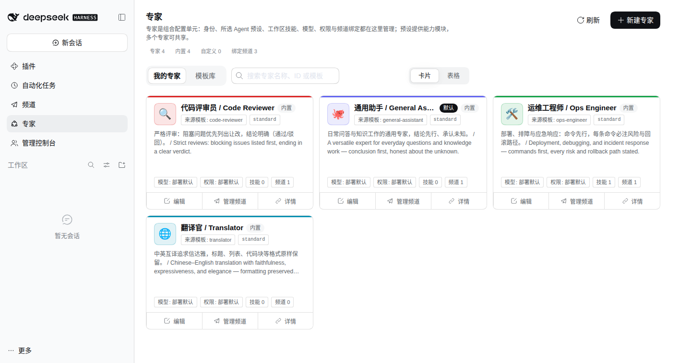
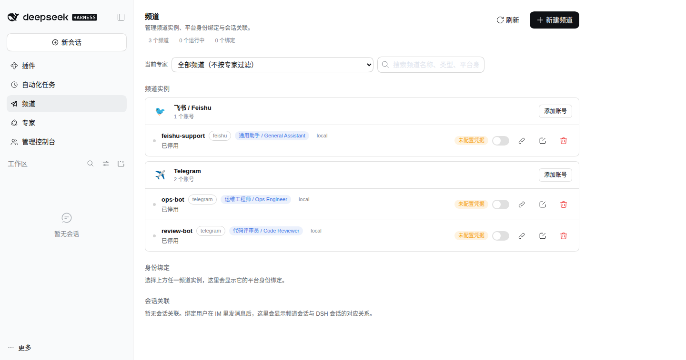
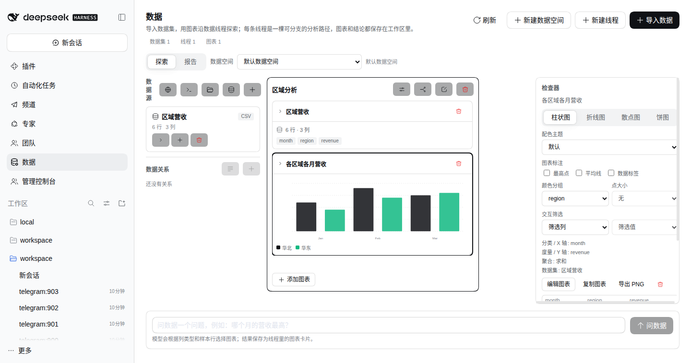

# @tentacle/bundle (dsh-tentacle-bundle)

[English](README.md) | 中文

用户唯一直接安装的包。通过 bundle patch 层聚合所有 Tentacle 插件与调好的默认配置——启用即大变样。

```bash
dsh plugin --profile web add dsh-tentacle-bundle
```

## 它长什么样



<table>
  <tr>
    <td width="50%">
      
      <br><sub><b>频道</b> — 8 个 IM 平台，平台身份映射为租户会话。</sub>
    </td>
    <td width="50%">
      
      <br><sub><b>数据工作台</b> — 数据集、可分支线程、图表与报告。</sub>
    </td>
  </tr>
</table>

patch 层按依赖序插入：

| 条目 | 包 | 作用 |
|---|---|---|
| `tentacle-identity` | `@tentacle/identity` | 可插拔身份（本地零配置默认） |
| `tentacle-gateway` | `@tentacle/gateway` | 认证反向代理（默认直通模式） |
| `tentacle-tenancy` | `@tentacle/tenancy` | 用户目录、邀请、资源策略、ReBAC memberships |
| `tentacle-persona` | `@tentacle/persona` | 专家库——专家选择共享 Agent 预设，并拥有工作区技能/路由/频道绑定 |
| `tentacle-teams` | `@tentacle/teams` | 专家团队——名册 + 协作契约，挂载为一个受管 team preset |
| `tentacle-data` | `@tentacle/data` | 数据工作台——数据集、可分支数据线程、图表卡片 |
| `tentacle-channels` | `@tentacle/channels` | IM 频道（飞书、Telegram、钉钉、企微、QQ、微信、元宝、Discord）——绑定后的平台身份映射为租户会话。适配器默认**关闭** |

在 profile 的 `cordis.patch.yml` 里按条目 id 覆盖配置（config 是整体替换——要保留的字段需重述）。

设计文档：[docs/design/04-architecture.md](../../docs/design/04-architecture.md)。

## 许可证

MIT
