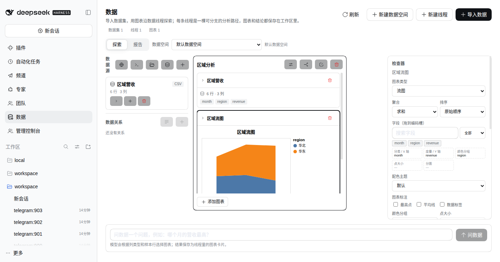
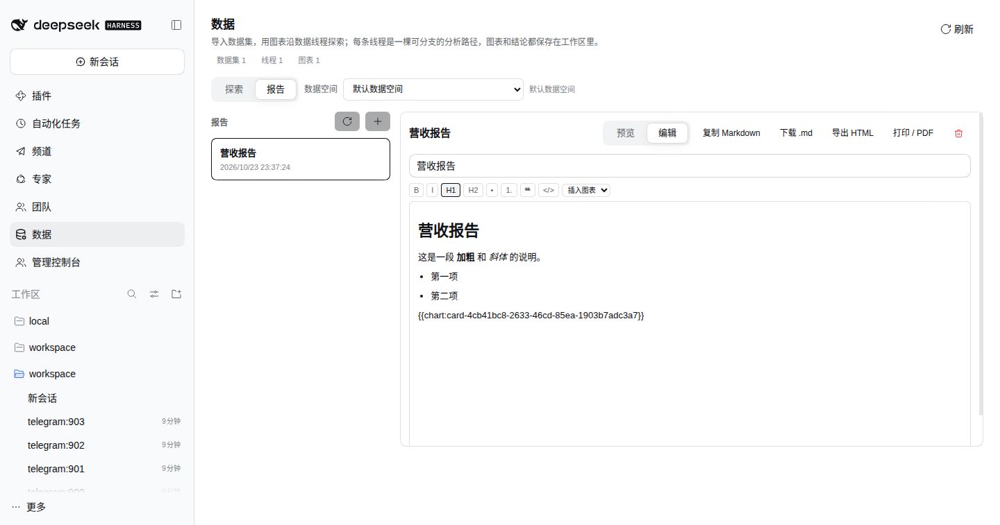

# @tentacle/data

Data Studio for DSH: import datasets, explore them as **branching data threads**, and keep chart cards in a persisted data workspace.

The shape is borrowed from Microsoft's Data Formulator (MIT): data sources on the left, thread columns in the middle, an inspector on the right; a thread is a branchable analysis path rather than a chat log.


## Screenshots

<table>
  <tr>
    <td width="50%">
      
      <br><sub><b>Flint charts</b> — 39 templates compiled to Vega-Lite and rendered as SVG.</sub>
    </td>
    <td width="50%">
      
      <br><sub><b>Reports</b> — Tiptap editing, Markdown persistence, live <code>{{chart:id}}</code> embeds.</sub>
    </td>
  </tr>
</table>

## What it owns

- **Data spaces**: named workspaces grouping datasets and threads under `$DSH_HOME/tentacle/data`.
- **Datasets**: CSV/JSON import with type inference; normalized rows stored once per dataset, metadata in `state.json`.
- **Threads**: one analysis line, forkable; fork copies its cards into a new thread.
- **Cards**: dataset anchors, chart cards and notes; a card is a persisted first-class object in its thread.
- **Native chart renderer**: bar / line / area / scatter / pie / donut / horizontal-bar / heatmap / boxplot, dependency-free SVG.
- **Flint chart renderer**: bump / streamgraph / waterfall / rose / radar / grouped-bar / stacked-bar / candlestick / gantt / histogram / density / violin / kpi / range-area / bullet / bar-table / table / range-dot / map / choropleth, compiled to Vega-Lite and rendered as SVG. Map templates use Vega's world basemap URL.
- **Chart properties**: Flint's applicable options (corner radius, opacity, axis type, …) become inspector controls and are written back to `ChartSpec.chartProperties`; all specs are validated against dataset columns.
- **Derived datasets**: one explicit `group` (group by + aggregate) or `filter` operation creates a new dataset with provenance (`sourceDatasetId`, `operation`), added to the thread as a dataset card. The agent can chain two transforms into a final chart.
- **SQLite connector**: upload a `.sqlite`/`.db` file; the host lists user tables and imports one table as a normalized dataset. The upload lives only for the connector session and is deleted on close.
- **URL connector**: server-side fetch of a remote CSV/JSON document (http(s), 10 MB, 15 s), then the same normalized import path. Useful for public data URLs and APIs.
- **Workspace-file connector**: browse registered DSH Workspaces through `ctx.workspaceRegistry`; only CSV/JSON files inside the workspace are readable, with traversal and symlink-escape checks.
- **PostgreSQL / MySQL / SQL Server connector**: one-shot `connect → list tables → import one table`; lazy `pg`/`mysql2`/`mssql` drivers, 10 s connection / 15 s query timeouts, 20k row cap. Credentials travel with the request only and are never persisted. A second mode imports a single read-only `SELECT`/`WITH` query (20k row cap).
- **S3 / Azure Blob connector**: one-shot object listing + import (CSV/JSON, 20 MB cap); lazy AWS/Azure SDKs, credentials request-only.
- **Saved connections**: database/object-store configs can be saved by name; the secret is written to the DSH credential store (`TENTACLE_DATA_CONN_*`) and never enters Data Studio state. Selecting a profile resolves the secret per operation.
- **DuckDB connector**: upload a `.duckdb` file (64 MB cap), list `main` tables and import one; read-only, temporary upload removed on close.
- **Refreshable sources**: URL and workspace-file datasets keep their source (`source.kind = url | workspace`). `POST /datasets/refresh` re-fetches/re-reads and replaces rows in place, preserving the dataset identity and bumping `refreshedAt`.
- **Auto refresh**: per-dataset cadence (1m/5m/15m/1h); the host runs due refreshes on a 15s tick and records `lastRefreshError` without discarding the last good rows. The browser polls the panel while auto-refresh is active.
- **Data memory**: `DataRelation` records a key relationship between two datasets (`left.column = right.column`). A relation can be used by the manual join dialog or by the agent. Discover suggestions from same-named columns with ≥60% sampled value overlap (`GET /relations/suggest`); nothing is saved until confirmed.
- **Joins**: one explicit key pair with `inner`/`left` mode creates a persisted dataset (`join` provenance); colliding right columns are aliased `_right`.
- **Reports**: Markdown documents persisted per data space, with `{{chart:<cardId>}}` embeds rendered by the live chart card. Reports can be generated from a thread, edited with a Tiptap rich-text editor (Markdown stays the stored format, `{{chart:<id>}}` tokens embed live cards), copied, downloaded as `.md`, exported as standalone HTML with inlined chart SVGs, or printed to PDF.
- **Chart recommendations**: schema-shape suggestions (date→line, category→bar/pie, two measures→scatter, category-only→count) with live previews and one-click insertion into the active thread.
- **Chart styling**: four themes (`default/warm/cool/mono`), chart-type switching, one-click duplication, and annotations (max point / mean line / data labels).
- **Encoding channels**: `color` / `size` / `facet`, grouped bars and multi-series lines, colored/sized scatter points, small multiples, numeric range controls and category sort.
- **Inline quick config**: every chart card carries a compact bar for type, theme swatches and annotation toggles.
- **Draggable field shelf**: search/type-filter the dataset columns and drop one onto X / Y / color / size / facet.
- **AI chart refinement**: `POST /charts/refine` asks a model for a validated spec patch (type/theme/annotations/encodings). Each result is stored as a named style variant (original + last 8) and can be re-applied from the inspector.
- **Interactive filters**: categorical filters stored on the chart spec (`filters: [{ column, values }]`) are applied before aggregation, editable from the chart inspector without changing the dataset.
- **Thread controls**: categorical filters and numeric ranges stored on the thread (`threads/filters`) apply to every chart in that thread; datasets without the column ignore them.
- **Export**: dataset CSV (`rowsToCsv`) and chart PNG (SVG → canvas) from the inspector; reports export as Markdown, standalone HTML with inlined SVGs, or print/PDF.
- **Panel**: admin-only global `main` panel + `sidebar.panellist` icon (`tentacle-data`), next to experts/teams/channels.

## REST surface

Served at the Tentacle gateway seat, admin (or `data` permission) only:

```
GET  /tentacle/api/data                 state (workspaces/datasets/threads/cards)
GET  /tentacle/api/data/datasets        dataset rows (query id, limit)
POST /tentacle/api/data/workspaces/*    create | rename | remove
POST /tentacle/api/data/datasets/*      import | derive | join | remove
POST /tentacle/api/data/relations/*     create | remove
POST /tentacle/api/data/threads/*       create | fork | rename | remove
POST /tentacle/api/data/cards/*         create | update | remove
POST /tentacle/api/data/charts/refine    model-driven chart refinement
POST /tentacle/api/data/agent/stream     SSE agent run + live plan steps
POST /tentacle/api/data/reports/*       create | update | remove
POST /tentacle/api/data/connectors/sqlite/*  open | import | close
POST /tentacle/api/data/connectors/database/*  test | import | query
POST /tentacle/api/data/connectors/duckdb/*    open | import | close
POST /tentacle/api/data/connectors/objectstore/*  test | import
POST /tentacle/api/data/datasets/import-url  remote CSV/JSON
GET  /tentacle/api/data/connections     saved database/object-store profiles
POST /tentacle/api/data/connections/*   create | remove
GET  /tentacle/api/data/workspaces      registered DSH workspaces
GET  /tentacle/api/data/files           one directory level (workspaceId, path)
POST /tentacle/api/data/datasets/import-workspace  workspace CSV/JSON
POST /tentacle/api/data/datasets/refresh  URL/workspace-backed datasets
POST /tentacle/api/data/datasets/auto-refresh  cadence seconds (0=off)
```

## Data Agent

A one-shot model call (`POST /tentacle/api/data/agent`) receives a thread, a question and the active dataset's schema + sample rows. The reply is strict JSON:

- a chart instruction → validated against columns and saved as a chart card (+ an explanation note);
- a `transform` instruction → validated `group`/`filter` operation, persisted as a derived dataset card, then fed back to the model;
- a `join` instruction → validated against another workspace dataset and known relationships, persisted as a joined dataset card;
- an `answer` → saved as a note when the data cannot answer.

The service runs a bounded chain (max 3 model calls) so one question can become `transform → chart` without client-side planning. Each question leaves a `plan` card in the thread listing the actions the agent took (derived/joined dataset, chart, answer); `POST /agent/stream` emits SSE step events while the model runs, and the plan card moves running → done/error.

The runtime is `ctx.llm` with the `agentDefaultModel` selection; without a model provider the endpoint returns `503 agent-unavailable` and the panel keeps working.

## Deliberate MVP boundaries

- The agent chain is bounded at 3 steps and chooses only one action per model call; free-form long plans are out of scope.
- Derived datasets keep provenance but are not automatically re-derived when the source changes.
- Connectors are deliberately one-shot (open → list → import → close). Persistent sync jobs and warehouse catalogs are out of scope.
- Charts split into two backends: a dependency-free SVG renderer for the core chart types, and Flint/Vega for the remaining Flint templates. Both sit behind the same `ChartView`, so the thread model does not know which renderer draws a card.
- Reports are in-app artifacts with live chart embeds; the official DSH deliverables sidebar is still a future slice.
- Relationship suggestions use same-named columns plus sampled value overlap; multi-hop join planning is still a future slice.
- SQLite/DuckDB uploads are one-shot; URL and workspace-file datasets support manual or scheduled refresh. Credentials for database/object-store connectors are request-only and never persisted.
- Chart recommendations are structural (types + cardinality); they do not rank by analytical intent or data variance yet.
- Large-data execution (DuckDB) is still a future slice; joins run over the in-memory normalized rows.

## License

MIT.
